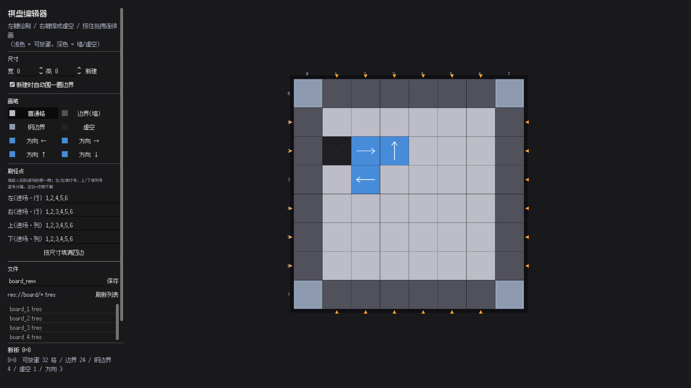

# 棋盘编辑器（Board Editor）

可视化做 `res://board/*.tres` 的小工具，免得在纸上画完再一格一格填资源。

## 打开方式

在 Godot 里打开 `tools/board_editor/board_editor.tscn`，按 **F6**（运行当前场景）单独运行。
它不依赖游戏主场景，直接操作 `res://board/` 下的 tres。

## 用法

1. **尺寸**：填宽/高（3~30），点“新建”。勾选“自动围一圈边界”会先把最外圈铺成墙。
2. **画格子**：左边选画笔，在右边网格上按住左键拖动即可连续画；右键擦成“虚空”。
   - 普通格：可放蛋
   - 边界(墙)：`is_edge` + 碰撞，耐久 100，会被敌人打掉
   - 钢边界：和边界一样挡路，但不可破坏（拐角用，告诉玩家这里不用守）
   - 虚空：不可用、不显示
   - 方向 ← → ↑ ↓：可发射方向格
3. **刷怪点**：填的是敌人**实际进场的那一侧**，左/右填行号、上/下填列号，逗号分隔（例如 `1,2,3`）。
   画布边缘的橙色小三角就是当前刷怪点；“按尺寸填满四边”会填成 1..n-2。
   底层 `enemy_spawn_point_*` 同样按进场侧命名（`left` = 从左边进场），和界面上的一一对应。
4. **保存**：填文件名（不用写 `.tres`），点保存 → 写到 `res://board/<名字>.tres`。
5. **读取/修改**：下方列表点一下即可载入 `res://board/` 里的某块板，改完再保存。
   载入 `board_1.tres` 这种已有板子时，原有的格子资源和刷怪点会被原样保留，只有你涂过的格子会变。

## 注意

- 新板保存后还要在 `floor_data.gd` 的 `board_weights_tables` 里加上名字，游戏才会随机到它。
- 保存的 tres 里格子引用的是 `res://board/cells/*.tres` 预设资源，和手写的板子格式一致。
- 编辑器只负责 `BoardData`（size / grid / 四边刷怪点），不碰楼层、权重等其他配置。
